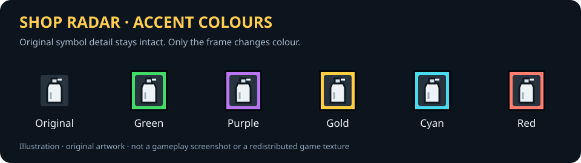

# GTA III Shop Radar

An ASI mod for classic GTA III on Windows that shows nearby shops and services on the radar. Icons appear when you get close and fade out at a configurable radius. Loose weapon pickups are not included.

**Beta.** No crashes have been observed in testing on the classic Steam version so far. Some gameplay situations have not been fully tested yet; see [test status](docs/VALIDATION.md), [known issues](docs/BUGS.md) and the [installation guide](INSTALL.md).



## Choosing a version

**This revision: hybrid discovery enabled by default.**

| Tag | Behaviour |
| --- | --- |
| `v0.1.0-fixed` | Only the ten verified stores/services; no discovery code. |
| `v0.1.0-discovery` | Same verified catalogue plus bounded dynamic discovery of additional services. |

Download the compiled ZIP from the matching release. Install only one Shop Radar ASI at a time. GitHub's **Code → Download ZIP** is source code, not a compiled mod. To build from source, check out either tag and run `build.ps1`. This version can also be limited to the fixed catalogue with `General/DynamicDiscovery=0`.

## Locations

- Two Ammu-Nation stores (Portland and Staunton).
- Phil's Army Surplus in Rockford.
- Three Pay 'n' Spray garages.
- Three 8-Ball bomb garages.
- The purchasable weapons behind the Shoreside Vale police station.

Default radius: **250 world units**, adjustable from **50 to 1000**, in steps of 50. Distance is horizontal. Icons fade over the outer 15% of the radius. Outside the radius, this mod draws no icon. Within the radius, an icon may sit at the radar edge if the radar's current zoom covers a smaller area.

Icons are drawn without allocating radar blips or writing to save files. In free roam, original weapon/spray/bomb sprite calls are filtered and replaced by the catalogue. Original mission markers remain intact, including with a category disabled. The mod draws first and native markers draw afterward so native markers have overlap priority; matching mission shop markers suppress duplicates. Turning the entire mod off restores original marker behaviour.

Weapon services use actual shop/out-of-stock pickup records; garages use service type, bounds and deactivation state. Known disabled/out-of-stock services are hidden. During missions, additional icons require available state and use **60% of the chosen display radius** by default, adjustable from 25% to 100% in the Mission radius row (`General/MissionRadiusPercent`). Mission garage checks also reject unsuitable vehicles, existing bombs and fixed-colour resprays on the Steam version. On foot, an active garage describes the business rather than an immediately usable vehicle service. Unknown state is hidden during missions. These checks do not cover every mission-specific access condition; see [test status](docs/VALIDATION.md) and [similar mods](docs/RESEARCH.md).

## Hybrid service discovery

The ten verified locations remain the baseline. With `General/DynamicDiscovery=1` (default), the mod also reads validated classic garage and pickup records every 250 ms:

- Additional spray/bomb garages require explicit service types and plausible bounds. Bomb type comes from the garage record, not its island.
- Additional weapon shops require at least two distinct weapon models in nearby for-sale/out-of-stock records on the same storey. Loose pickup types and uncertain single-item sellers are excluded.
- Same-family candidates near a known or discovered service are merged. Known coordinates are never moved or replaced. No discoveries are written to a save or cached across sessions.
- Extra services use the existing category/radius/mission/size/colour controls and icon separation. **Other weapon shops** controls both the original Shoreside dealer and discovered weapon sellers; its INI section stays `Shoreside weapon dealer` for compatibility.

Set `DynamicDiscovery=0` in the INI while the game is closed to keep only the verified catalogue. Discovery is an INI setting, not a menu row. Up to 64 additional services are kept. On the original map, discovery finds no extra services because all ten are already in the catalogue; it is meant for future map additions using the standard game records. Relocated/expanded record pools and nonstandard service types are not supported.

## Recommended setup

The classic Steam release of GTA III has known problems with the mouse, menus and widescreen display. Shop Radar was developed and tested together with these community fixes, and we recommend installing them:

- [SilentPatch III](https://silentsblog.com/mods/gta-iii/): fixes many bugs in the original game, including mouse and menu issues.
- [GTA III Widescreen Fix](https://github.com/ThirteenAG/WidescreenFixesPack/releases/tag/gta3): correct widescreen presentation and HUD/menu scaling.
- [Ultimate ASI Loader](https://github.com/ThirteenAG/Ultimate-ASI-Loader): loads ASI mods. **This is the only actual requirement.**

Shop Radar is a standalone mod. These projects are made by other authors and are not bundled; follow their own installation instructions.

## Compatibility and save behaviour

| Configuration | Status |
| --- | --- |
| Classic Steam, English | Tested; no crashes observed |
| SilentPatch III + Widescreen Fix | Tested together |
| Classic retail 1.0 / 1.1 | Address tables included; not tested in game |
| Definitive Edition / other executable variants | Unsupported |
| Mod Loader, other radar/menu/HUD mods | Not tested; shared hooks/menu tables can conflict |
| Map/script conversions | Not supported; shop coordinates are for the original map |

The mod does not write saves or replace main.scm, so no new game is needed. As with any beta mod, keep a backup of saves you care about. Do not replace the ASI while the game is running.

Credits are in [THIRD_PARTY.md](THIRD_PARTY.md); the code is licensed under [MIT](LICENSE). To report a bug, open an issue with the game version, other installed mods and exact reproduction steps. Do not attach saves.

## Installation

Requires an ASI loader with support for the `InitializeASI` export ([Ultimate ASI Loader](https://github.com/ThirteenAG/Ultimate-ASI-Loader)). Close the game and copy `GTA3.ShopRadar.asi` and `GTA3.ShopRadar.ini` from the compiled ZIP into a loader-enabled `scripts` folder. Keep an existing INI if upgrading. See [INSTALL.md](INSTALL.md) for file layout, controls and troubleshooting.

Open **Options → Shop Radar**, an ordinary row in the game's settings list. This also works before loading a game. If the native menu table cannot be validated, a floating launcher remains as a fallback. F7 opens the page from pause home, Options or Display. Before loading a save, menu previews are read from the local classic models/hud.txd; once available, the game radar sprites are used. Mouse clicks cycle values; keyboard controls:

- Up/down: select a row.
- Tab: choose Show, Icon, or Colour.
- Left/right: change the selected setting.
- Enter/Space: toggle or cycle forward.
- Escape/Backspace/F7: return to the normal pause menu.

Settings save automatically beside the ASI. Seven selectable icon choices (six original icons and automatic Bomb type) and six colour modes are available, with an icon preview. No downloaded art assets are needed. Gamepad controls and importing external icon artwork are not implemented.

The Icon size row sits immediately below Mod enabled and cycles 75%, 100% and 125% for all custom shop icons and their previews. All colour modes share the same pictogram size. Native mission markers retain their own game size.

Icon choices change the appearance of the selected service category. Cartel is the game's C mission icon; selecting it does not add a weapon seller or mark a new location. Green, Purple, Gold, Cyan and Red (INI values 1–5) add an outlined accent frame. The pictogram stays untinted, preserving the spray can's highlights and other details. Red includes a dark inner separator so red icon artwork remains distinct from the accent. Original (0) has no extra frame.

The mod checks executable version signatures and required hooks before installing them. English classic 1.0, 1.1 and Steam address tables are included. Definitive Edition is unsupported. Failures are logged to `scripts/GTA3.ShopRadar.log`.

To uninstall, close the game and remove just `GTA3.ShopRadar.asi`, its INI and its log from `scripts`.

### Bomb service icons

Choose **Bomb type** for the original in-game bomb-shop logo with an activation badge: key (Portland ignition), clock (Staunton timer), transmitter (Shoreside remote). When the Bomb Shops row is selected with Bomb type, the menu shows all three previews together. These identify the service sold, not whether your vehicle is armed. New installations default to Bomb type; existing INI choices are preserved, and old per-type INI choices 7-12 migrate to Bomb type. The native logo is drawn from the game at runtime; only small badge shapes are built into the mod.

Nearby custom radar icons are nudged slightly apart when they overlap, staying close to their real position. Their world coordinates are unchanged; native mission markers still draw on top.

## Building

Download Zig **0.15.2** from <https://ziglang.org/download/0.15.2/>. On Windows:

```powershell
./build.ps1 -Zig 'C:/path/to/zig.exe'
```

This builds a **32-bit Windows DLL with an `.asi` extension**, runs the tests and packages the mod. Plugin-SDK was used as an ABI reference; the mod has no runtime or build dependency on Plugin-SDK. Toolchains, SDK checkout, game scripts and game files are excluded from Git.

## Development

`src/Policy.h` contains the catalogue, radius policy and settings. `src/Services.h` classifies stock and garage records. `src/RenderStyle.h` defines the palette/frame geometry. `src/ShopRadar.cpp` contains the Windows INI handling, game ABI bridge, radar drawing and settings UI. Contributor guidelines are in `AGENTS.md` in the source repository.

`scripts/check-publication.ps1` is an offline check that release files contain no unexpected files, local paths or credential-like strings.

This repository contains only the mod's own code, not Rockstar game files.
